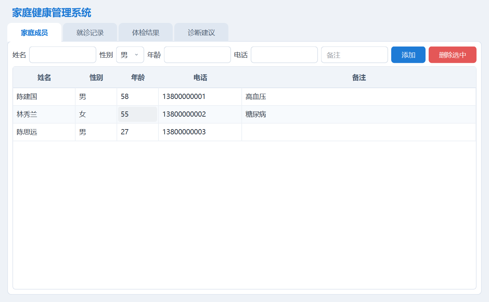
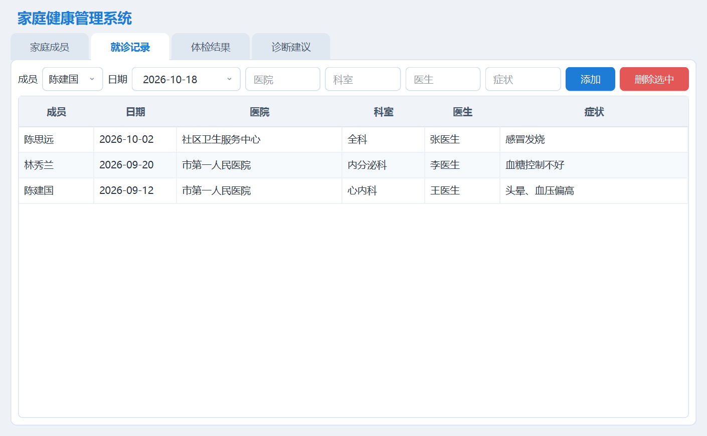

# 家庭健康管理系统

Qt6 课程设计作业。用 SQLite 存数据，先登录（账号存在数据库里，可以自己注册），进去以后四个页签，实现家庭成员、就诊记录、体检结果、诊断建议的录入和查看。

## 登录与注册

启动先弹登录窗口：


程序第一次运行会自动建一个管理员账号：

| 用户名 | 密码 |
| --- | --- |
| `admin` | `123456` |

点「注册」可以自己建账号：


注册规则：用户名至少 3 个字符、不能重复；密码至少 6 位，要输两遍确认。注册成功后用户名会自动填回登录框。

账号存在数据库的 `user` 表里，密码经过 MD5 转换后才存，数据库里看不到明文。

## 主界面



四个页签的用法都一样：上面一行填内容，点「添加」写进数据库；下面表格里选中一行，点「删除选中」。窗口标题会显示当前登录的用户名。

| 页签 | 能填的字段 |
| --- | --- |
| 家庭成员 | 姓名、性别、年龄、电话、备注 |
| 就诊记录 | 成员、日期、医院、科室、医生、症状 |
| 体检结果 | 成员、日期、检查项目、结果、单位 |
| 诊断建议 | 成员、日期、诊断结果、康复建议 |



## 运行

直接双击 `dist/HealthManager.exe`。

第一次运行会在 exe 同目录生成 `health.db`，自动建表并写入 1 个管理员账号、3 个成员、3 条就诊、4 条体检、3 条诊断的测试数据。想全部清空就删掉 `health.db` 再打开。

## 代码结构

```
main.cpp            启动程序、全局样式表
database.h/.cpp     打开数据库、建表、插入测试数据、MD5 加密
logindialog.h/.cpp  登录窗口
registerdialog.h/.cpp 注册窗口
mainwindow.h/.cpp   主窗口，四个页签的功能都在这里
```

数据库五张表：

| 表 | 作用 |
| --- | --- |
| `user` | 登录账号（用户名、密码、角色） |
| `member` | 家庭成员 |
| `visit` | 就诊记录 |
| `exam` | 体检结果 |
| `diagnosis` | 诊断建议 |

后三张用 `member_id` 关联到成员表，查询的时候用 `LEFT JOIN` 把成员名字取出来显示。

因为登录发生在主窗口之前，所以建库的代码单独放在了 `database.cpp`，`main()` 里先 `openDatabase()` 再弹登录框。

## 已知不足

- **不能修改**，只能添加和删除。改记录得删掉重填。
- **没有权限控制**。`user` 表里有 `role` 字段（管理员 / 普通用户），但登录后不区分，两种账号看到的界面完全一样。
- **MD5 存密码不安全**，真实项目应该用 bcrypt 之类的加盐哈希。
- **没有输入校验**，年龄填字母会变成 0，日期也不检查。
- **没有事务**。删除成员时是先删三张子表再删主表，中间出错不会回滚。
- **体检只有一行一个指标**，没有"一次体检包含多项"的概念。
- **没有搜索、没有统计、没有图表**。
- 数据库路径是相对路径，在哪个目录启动就在哪里生成 `health.db`。

## 编译

需要 Qt6（含 Widgets、Sql 模块）和 CMake。

```bash
cmake -S . -B build -G Ninja -DCMAKE_PREFIX_PATH=E:/Qt/6.12.0/mingw_64
cmake --build build
```

